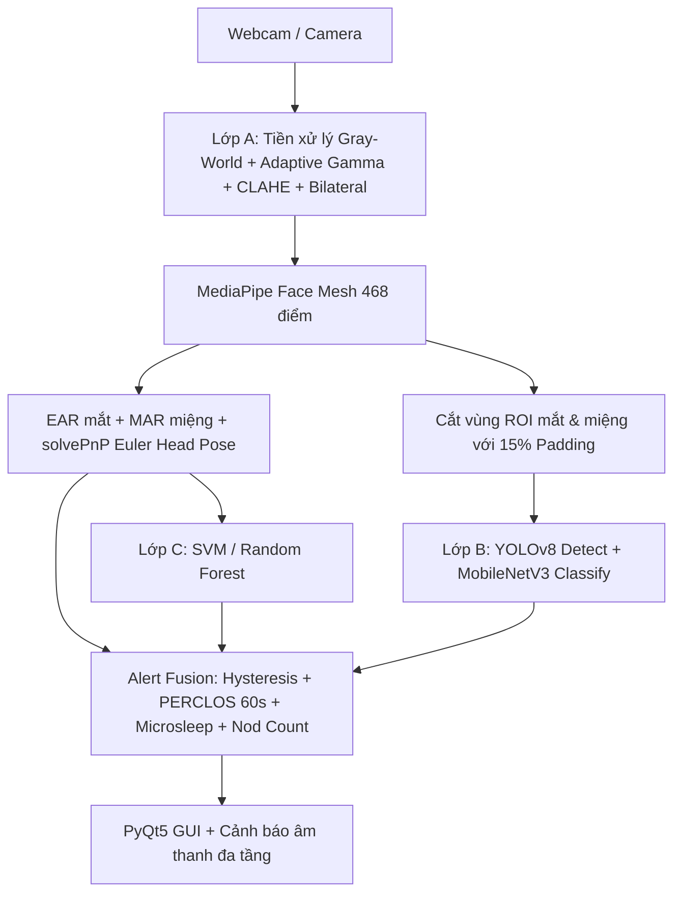

# Micro-Sleep: Hệ Thống Phát Hiện Buồn Ngủ Khi Lái Xe Thời Gian Thực (DMS)

> Đồ án môn **Xử lý ảnh & Thị giác máy tính**: Giám sát trạng thái tài xế thời gian thực bằng camera thông thường thông qua kết hợp xử lý ảnh hình học cổ điển (EAR, MAR, Pose, PERCLOS), học sâu (YOLOv8 / MobileNetV3) và học máy truyền thống (SVM / Random Forest).  
> Chi tiết báo cáo lý thuyết và thực nghiệm xem tại: [`BAO_CAO_DO_AN.md`](BAO_CAO_DO_AN.md).

---

## 🚀 Các Tính Năng Nổi Bật

1. **Xử lý ảnh nâng cao cho điều kiện đêm tối & cabin thiếu sáng:**
   - **Adaptive Gamma Correction:** Tự động đo độ rọi và tính hệ số $\gamma$ động bằng bảng tra LUT $O(1) < 1\text{ms}$, cứu sáng các vùng tối cục bộ mà không làm cháy sáng các nguồn đèn ngược chiều.
   - **Bilateral Filter:** Khử nhiễu cảm biến ISO cao ban đêm mà bảo toàn nguyên vẹn độ sắc nét của viền mi mắt và khóe môi.
   - **Cơ chế Fallback thông minh:** Phân cấp cảnh báo an toàn khi mất dấu khuôn mặt hoặc cabin quá tối thay vì im lặng.

2. **Hệ thống cảnh báo đa tầng & Âm thanh phân cấp:**
   - **EARLY (Cảnh báo sớm):** Nhịp bíp nhẹ $900\text{Hz}$ khi ngáp nhiều lần hoặc lệch góc đầu quá lâu.
   - **FATIGUE (Cảnh báo mệt mỏi):** 2 nhịp cảnh báo khi tỷ lệ nhắm mắt tích lũy $\text{PERCLOS}_{60s} > 30\%$.
   - **STRONG (Báo động khẩn cấp):** Còi hú 3 nhịp dồn dập tần số cao ($1800\text{Hz} - 2200\text{Hz}$) khi rơi vào giấc ngủ ngắn (Microsleep $\ge 1.0\text{s}$) hoặc mất dấu tài xế quá $4\text{s}$.

3. **Giao diện điều khiển động (Dynamic UI) & Tự động cân chỉnh (Auto-Calibration):**
   - **Auto-Calibration (3 giây):** Tài xế nhìn thẳng camera 3s, hệ thống tự động đo dáng mắt tự nhiên và tính ngưỡng đóng/mở mắt cá nhân hóa.
   - **Thanh trượt thời gian thực:** Trực tiếp điều chỉnh ngưỡng `EAR Nhắm`, `MAR Ngáp`, `Microsleep`, `Độ tin cậy DL` ngay trên màn hình.
   - **Tùy chọn bật/tắt:** Âm thanh đa tầng, Adaptive Gamma, Bilateral Filter, nút Reset cấu hình mặc định.

4. **Tự động khắc phục lỗi môi trường Windows:**
   - Tự động phát hiện và ánh xạ ổ đĩa ảo `Z:` để triệt tiêu lỗi đường dẫn Unicode tiếng Việt đối với các thư viện C++ (PyQt5, MediaPipe binarypb).
   - Tối ưu driver camera sang **DirectShow (`cv2.CAP_DSHOW`)**, loại bỏ hoàn toàn lỗi kẹt luồng `MSMF grabFrame`.

---

## 📂 Kiến Trúc Hệ Thống (3 Lớp)



---

## 🛠️ Hướng Dẫn Cài Đặt & Chạy Ứng Dụng

### 1. Cài đặt môi trường
Khuyến nghị sử dụng Python 3.10 – 3.12:

```bash
# Tạo và kích hoạt môi trường ảo
python -m venv venv
.\venv\Scripts\activate

# Cài đặt các thư viện cần thiết
pip install -r requirements.txt
```

### 2. Chạy ứng dụng

* **Cách 1 (Nhanh nhất):** Nhấp đúp chuột vào file `run.bat` trên Windows.
* **Cách 2 (Giao diện PyQt5 đầy đủ):**
  ```powershell
  python DrowsinessDetector.py
  ```
* **Cách 3 (Bản chạy thuần OpenCV siêu nhẹ):**
  ```powershell
  python run_opencv.py
  ```
  *(Phím tắt trên cửa sổ OpenCV: `C` để cân chỉnh 3s, `M` bật/tắt âm thanh, `G` bật/tắt Gamma, `Q` để thoát).*

---

## 📊 Huấn Luyện Dữ Liệu (Model Training)

### 1. Chuẩn bị dữ liệu
```bash
# Thu thập ảnh thực tế qua webcam
python CaptureData.py

# Xuất dataset mắt (đầy đủ cả nhãn 0 = open, 1 = close)
python prepare_eye_dataset.py --out datasets/eye --max-samples 8000
```

### 2. Huấn luyện mô hình
```bash
# Train mô hình YOLOv8 phát hiện mắt / ngáp
python train_yolo.py --task eye --epochs 80 --batch 16
python train_yolo.py --task yawn --epochs 80 --batch 16

# Train bộ phân loại MobileNetV3 trên vùng ROI
python train_classifier.py --task eye --arch mobilenet --epochs 20

# Train mô hình học máy truyền thống SVM / Random Forest
python train_traditional.py --csv logs/session_sample.csv

# Đánh giá độ chính xác (Confusion Matrix, Precision, Recall)
python evaluate.py --csv logs/session_sample.csv
```

---

## 📁 Cấu Trúc Thư Mục

```text
├── cv_core/                  # Thư viện xử lý ảnh cốt lõi
│   ├── preprocess.py         # Adaptive Gamma, Gray-World, CLAHE, Bilateral Filter
│   ├── geometry.py           # Công thức hình học EAR, MAR, solvePnP Head Pose
│   ├── fusion.py             # Hợp nhất cảnh báo đa tầng, Hysteresis, PERCLOS
│   ├── dl_models.py          # Wrapper nạp mô hình YOLOv8 & MobileNetV3
│   ├── traditional.py       # Mô hình SVM & Random Forest trên vector hình học
│   ├── overlay.py            # Vẽ trực quan mốc landmark, thanh PERCLOS
│   └── logger.py             # Ghi nhật ký phân tích thời gian thực
├── DrowsinessDetector.py     # Ứng dụng chính với GUI PyQt5 & Panel điều khiển
├── run_opencv.py             # Bộ chạy trực tiếp bằng OpenCV HighGUI
├── run.bat                   # Tự động gán ổ đĩa ảo & khởi chạy 1-click
├── dataset_eye.yaml          # Cấu hình dataset mắt cho YOLO
├── dataset_yawn.yaml         # Cấu hình dataset miệng cho YOLO
├── BAO_CAO_DO_AN.md          # Toàn văn báo cáo khoa học đồ án
└── requirements.txt          # Danh sách thư viện phụ thuộc
```

---

## 📜 Giấy Phép & Đóng Góp
Dự án phục vụ mục đích nghiên cứu, học tập môn Xử lý ảnh & Thị giác máy tính. Mọi đóng góp (Pull Request / Issue) đều được hoan nghênh!
